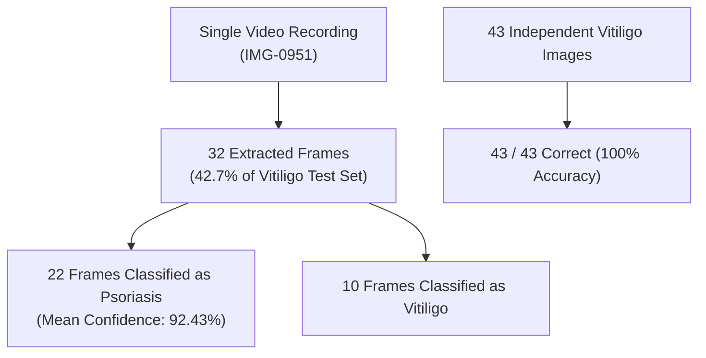

# ML-02: Reproducible Evaluation, Metrics & Reliability Assessment Report

## Executive Summary

This report establishes the verified reproducible evaluation baseline for the production EfficientNet-B0 skin disease classifier checkpoint (`models/trained/best_model.pth`).

- **Production Checkpoint**: `models/trained/best_model.pth`
- **MD5 Hash**: `FF106263793F9F0A2FB13F15CEB1437E` (Verified Unmodified)
- **Checkpoint File Size**: `16,367,097 bytes`
- **Evaluation Utility**: `ai/evaluation/reproducible_eval.py`
- **Command**: `.venv\Scripts\python ai/evaluation/reproducible_eval.py`
- **Test Dataset**: `data/split/test` (622 images across 7 classes)
- **Seed / Determinism**: Seed 42, deterministic evaluation mode

> [!CAUTION]
> This evaluation establishes an academic benchmark baseline on the existing held-out split. The reported metrics reflect known dataset limitations, including burst video frames without patient-level grouping and cross-split perceptual near-duplicates. **These metrics do not constitute clinical validation or clinical generalizability.**

---

## 1. Reproducible Baseline Metrics

### 1.1 Summary of Evaluated Metrics

| Metric | Measured Value | Historical / Reference | Notes |
|---|---|---|---|
| **Overall Accuracy** | **95.82%** (596 / 622) | 95.82% | Exact reproduction |
| **Balanced Accuracy** | **94.58%** | N/A | Macro-average recall |
| **Top-1 Accuracy** | **95.82%** | 95.82% | Matches overall accuracy |
| **Top-2 Accuracy** | **99.68%** (620 / 622) | N/A | 620/622 ground truths in Top-2 |
| **Top-3 Accuracy** | **100.00%** (622 / 622) | N/A | 100% of test samples in Top-3 |
| **Macro Precision** | **96.24%** | 96.24% | Exact reproduction |
| **Macro Recall** | **94.58%** | 94.58% | Exact reproduction |
| **Macro F1 Score** | **94.91%** | 94.91% | Exact reproduction |
| **Weighted F1 Score** | **95.67%** | 95.67% | Exact reproduction |
| **Multi-class Brier Score** | **0.0780** | N/A | Low mean squared probability error |
| **Expected Calibration Error (ECE)** | **2.88%** | N/A | 10-bin equal-width MSP partitioning |
| **Maximum Calibration Error (MCE)** | **61.24%** | N/A | Low-sample bin [0.3, 0.4] |

### 1.2 Per-Class Detailed Performance

| Class Index | Class Name | Precision | Recall | F1-Score | Support |
|:---:|:---|:---:|:---:|:---:|:---:|
| 0 | `acne_vulgaris` | 99.62% | 99.62% | 99.62% | 261 |
| 1 | `impetigo` | 100.00% | 92.59% | 96.15% | 27 |
| 2 | `molluscum_contagiosum` | 90.48% | 100.00% | 95.00% | 19 |
| 3 | `psoriasis` | 84.51% | 99.17% | 91.25% | 121 |
| 4 | `urticaria` | 99.09% | 100.00% | 99.54% | 109 |
| 5 | `vitiligo` | 100.00% | 70.67% | 82.81% | 75 |
| 6 | `warts` | 100.00% | 100.00% | 100.00% | 10 |

### 1.3 Confusion Matrix (Actual rows $\times$ Predicted columns)

```
Actual \ Predicted       Acne  Imp  Mol  Pso  Urt  Vit  Warts
acne_vulgaris (261)       260    0    1    0    0    0      0
impetigo (27)               1   25    0    0    1    0      0
molluscum_contagiosum (19)  0    0   19    0    0    0      0
psoriasis (121)             0    0    1  120    0    0      0
urticaria (109)             0    0    0    0  109    0      0
vitiligo (75)               0    0    0   22    0   53      0
warts (10)                  0    0    0    0    0    0     10
```

---

## 2. Vitiligo Misclassification Deep-Dive

### 2.1 The Phenomenon
In initial testing, `vitiligo` displayed a noticeably lower recall (**70.67%**, 53/75) compared to the overall model accuracy (95.82%), with **22 samples** predicted as `psoriasis`.

### 2.2 Root Cause Discovery: Burst Video Sampling Without Grouping
Sample-level path and metadata analysis of the 22 misclassified test images revealed:
1. **100% of the 22 misclassifications** (`IMG-0951_frame_6` through `IMG-0951_frame_36`) belong to a single video sequence (`IMG-0951`).
2. The `data/split/test/vitiligo` split contains a total of **32 video frames** extracted from this single video (`IMG-0951`), representing **42.67% of the entire vitiligo test class**.
3. **Of the 32 frames from `IMG-0951`**:
   - 22 frames were misclassified as `psoriasis`.
   - 10 frames were correctly classified as `vitiligo`.
4. **All 43 non-`IMG-0951` vitiligo test images were classified correctly** (43 / 43 = **100.0% accuracy**).



### 2.3 Characteristics of the Misclassified Frames
- **Mean Psoriasis Confidence on Error Frames**: **92.43%** (Min: 56.72%, Max: 99.84%).
- **Technical Image Quality**: All 22 frames passed image quality checks with status `good` (adequate Laplacian sharpness and lighting).
- **Clinical/Visual Significance**: The video frames depict hypopigmented patches with light reflection and framing that the CNN latent space associates strongly with plaque psoriasis or scaly dermatoses.
- **Key Takeaway**: The apparent drop in vitiligo recall is heavily magnified by pseudo-replication (multiple video frames from one patient) rather than widespread failure across diverse vitiligo patients.

---

## 3. Reliability & Calibration Audit

### 3.1 Model Overconfidence & Confidence Distributions

Summary statistics of maximum softmax probabilities:

| Subset | Sample Count | Mean Confidence | Median Confidence | Min Confidence | Max Confidence |
|---|---|---|---|---|---|
| **All Test Samples** | 622 | 97.79% | 99.69% | 38.76% | 99.99% |
| **Correct Predictions** | 596 | 98.11% | 99.71% | 38.76% | 99.99% |
| **Incorrect Predictions** | 26 | 90.46% | 97.86% | 52.89% | 99.92% |

### 3.2 Expected Calibration Error (ECE) Analysis
- **Expected Calibration Error**: **2.88%** across 10 equal-width bins.
- **Superficial Low ECE Reason**: 586 out of 622 samples (**94.2%**) fall into the highest confidence bin $[0.9, 1.0]$, where empirical accuracy (96.76%) is close to mean confidence (99.17%).
- **Overconfidence on Errors**: When the model is incorrect ($N=26$), the median confidence is **97.86%**. The model is strongly confident even when wrong.

### 3.3 Application Confidence Tiers & Abstention Assessment

The application defines three confidence tiers in `ai/safety/confidence_engine.py`:
- **High Tier**: $\text{Confidence} \ge 0.80$ (No caution flag)
- **Moderate Tier**: $0.60 \le \text{Confidence} < 0.80$ (Triggers caution flag)
- **Low Tier**: $\text{Confidence} < 0.60$ (Triggers caution flag)

#### Error Distribution Across Tiers:
- **High Tier ($\ge 0.80$)**: 603 samples, **22 errors** (3.65% error rate).
  - *All 22 vitiligo-to-psoriasis errors fell into this tier and bypassed caution flags.*
- **Moderate Tier ($0.60 - 0.80$)**: 12 samples, **1 error** (8.33% error rate).
- **Low Tier ($< 0.60$)**: 7 samples, **3 errors** (42.86% error rate).

#### Abstention Architecture Findings:
1. **Advisory Triage Escalation**: The system does **not** employ a hard classification abstention mechanism (it always emits a predicted class). Instead, it flags uncertainty in the UI and escalates triage (`routine` $\rightarrow$ `attention`).
2. **Caution Flag Sensitivity**: The confidence caution threshold ($< 0.80$) only captured **4 out of 26 errors** (**15.38% caution recall**), because 84.6% of errors occurred with confidence $\ge 0.80$.
3. **Hard Rejection Barrier**: The technical image quality module (`assess_image_quality`) is currently the sole hard gate that halts inference before CNN execution.

---

## 4. Evidence Required Before Future Model Promotion

Before any newly trained checkpoint can be considered for production promotion:

1. **Patient-Level Grouped Splitting**: Dataset splits must group all frames from the same video or subject into either train or test, preventing pseudo-replication artifacts.
2. **Perceptual Deduplication**: Near-duplicate pairs ($d \le 4$) identified in ML-01 must be isolated to prevent train-to-test leakage.
3. **Probability Calibration**: Implement post-hoc calibration (e.g. Temperature Scaling on validation logits) to align confidence with true empirical risk.
4. **Out-of-Distribution (OOD) Abstention**: Incorporate an energy-based or Dirichlet-based OOD detector to abstain rather than assign $>90\%$ confidence to ambiguous lesions.
5. **Class Support Expansion**: Ensure balanced test support (at least 50+ diverse subjects per class, especially for `warts` and `molluscum`).
