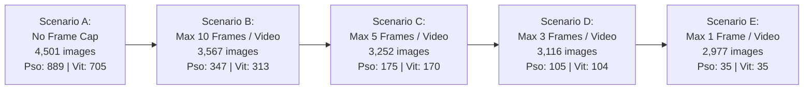

# TR-02B: Grouped Split Preparation, Manifest Validation & Frame-Cap Simulation Report

## Executive Summary

This report completes the TR-02B validation of the proposed grouped dataset manifest, provides visual review artifacts for uncertain perceptual near-duplicate groups, and evaluates multi-scenario video frame-cap simulations for **AI Skin Analysis V2**.

- **Production Checkpoint**: `models/trained/best_model.pth`
- **MD5 Hash**: `FF106263793F9F0A2FB13F15CEB1437E` (Verified Unmodified)
- **Active Split**: `data/split` (4,501 images across 7 classes — **Strictly Unmodified**)
- **Manifest Status**: **VALID & RECONCILED** ([`reports/proposed_group_manifest.csv`](file:///c:/SEM%205/AI-Skin-Analysis/reports/proposed_group_manifest.csv))
- **Machine-Readable Validation**: [`reports/grouped_split_validation.json`](file:///c:/SEM%205/AI-Skin-Analysis/reports/grouped_split_validation.json)
- **Visual Review Package**: Generated under [`reports/perceptual_review/`](file:///c:/SEM%205/AI-Skin-Analysis/reports/perceptual_review/) (37 contact sheets, review register with 117 entries)

> [!IMPORTANT]
> **No dataset directories were modified, no images were moved or deleted, and no physical split was created or activated.**

---

## 1. Independent Manifest Validation & Reconciliation Results

Exhaustive verification of [`reports/proposed_group_manifest.csv`](file:///c:/SEM%205/AI-Skin-Analysis/reports/proposed_group_manifest.csv) against the physical files in `data/split`:

| Check | Specification | Measured Result | Status |
|---|---|---|:---:|
| **A. Total Image Records** | Exactly 4,501 entries | **4,501** | **PASS** |
| **B. File Existence** | Every path maps to physical image in `data/split` | **4,501 / 4,501 exist** (0 missing) | **PASS** |
| **C. Duplicate Paths** | No duplicate relative paths in manifest | **0 duplicates** (4,501 unique paths) | **PASS** |
| **D. Label & Group Validity** | Valid class name and non-empty proposed group ID | **0 invalid classes, 0 missing IDs** | **PASS** |
| **E. Class Consistency** | Every group contains only images of the same class | **0 cross-class conflicts** | **PASS** |
| **F. Size Reconciliation** | Stated `group_size` equals actual member count | **0 size mismatches** across all groups | **PASS** |
| **G. Unique Groups** | Every image belongs to exactly one group | **2,440 distinct groups** | **PASS** |
| **H & I. Per-Class Totals** | Per-class group and image counts sum to global totals | **Images: 4,501, Groups: 2,440** | **PASS** |
| **J & K. Partition Assignment**| All groups assigned to exactly one partition | **Zero cross-split groups** | **PASS** |

---

## 2. Reconciled Group & Evidence Level Distribution

All 4,501 images in `data/split` are cataloged under 2,440 distinct groups across four evidence tiers:

| Evidence Level | Group Count | Image Count | Requires Human Review | Description |
|---|:---:|:---:|:---:|---|
| `verified_video_source` | 70 | 1,594 | **No** | Explicit sequential video frame stems (`IMG-XXXX_frame_YY`). |
| `probable_source_group` | 114 | 571 | **No** | Known synthetic prefixes (`imagelight`, `nosie`), copies, or burst numbers (`BA-impetigo (55)`). |
| `perceptual_candidate` | 37 | 117 | **YES** | Connected components with pHash distance $\le 4$ without shared filename stems. |
| `singleton_unknown` | 2,219 | 2,219 | **No** | Standalone unique images with no detected group links. |
| **Total** | **2,440** | **4,501** | **37 groups (117 images)** | |

### Reconciled Per-Class Breakdown

| Class Name | Total Images | Total Groups | Video Groups | Probable Groups | Perceptual Groups | Singletons |
|---|:---:|:---:|:---:|:---:|:---:|:---:|
| `acne_vulgaris` | 1,747 | 1,740 | 0 | 12 | 2 | 1,726 |
| `impetigo` | 188 | 144 | 0 | 73 | 2 | 69 |
| `molluscum_contagiosum` | 134 | 134 | 0 | 0 | 0 | 134 |
| `psoriasis` | 889 | 35 | 35 | 0 | 0 | 0 |
| `urticaria` | 749 | 312 | 0 | 227 | 85 | 196 |
| `vitiligo` | 705 | 35 | 35 | 0 | 0 | 0 |
| `warts` | 89 | 40 | 0 | 14 | 26 | 43 |
| **Total** | **4,501** | **2,440** | **70** | **326** | **115** | **2,219** |

---

## 3. Perceptual Candidate Visual Review Package

To resolve uncertain visual links without guessing clinical identities, a dedicated review package was generated in [`reports/perceptual_review/`](file:///c:/SEM%205/AI-Skin-Analysis/reports/perceptual_review/):

1. **Contact Sheets** ([`contact_sheets/`](file:///c:/SEM%205/AI-Skin-Analysis/reports/perceptual_review/contact_sheets/)):
   - **37 PNG contact sheets** generated locally comparing all images in each candidate group.
   - Thumbnails preserve aspect ratio, render filenames, and display group IDs.
2. **Review Register** ([`review_register.csv`](file:///c:/SEM%205/AI-Skin-Analysis/reports/perceptual_review/review_register.csv)):
   - 117 rows recording group ID, class, relative path, pHash cluster info, contact sheet path, and review status.
   - Initialized to `pending_review`.
3. **Review Guide** ([`README.md`](file:///c:/SEM%205/AI-Skin-Analysis/reports/perceptual_review/README.md)):
   - Detailed instructions for reviewers on permitted decisions:
     `confirmed_same_source`, `confirmed_duplicate`, `unrelated_images`, `uncertain`, `pending_review`.

---

## 4. Video Frame-Cap Simulations & Class Balance Analysis

Because psoriasis (889 images) and vitiligo (705 images) consist entirely of video frames across only 35 sequences each (up to 56 frames per video), four deterministic frame-cap scenarios were evaluated using evenly-spaced sampling:

### 4.1 Comparison Across Frame-Cap Scenarios

| Scenario | Frame Cap | Retained Images | Psoriasis Images | Vitiligo Images | Warts Images | Class Balance Assessment |
|---|:---:|:---:|:---:|:---:|:---:|---|
| **A. No Cap** | $\infty$ | 4,501 | 889 | 705 | 89 | **Severe Skew**: Pso + Vit dominate 35.4% of all images. |
| **B. Cap 10** | 10 | 3,567 | 347 | 313 | 89 | Moderate balance; retains 10 camera views per video. |
| **C. Cap 5** | 5 | **3,252** | **175** | **170** | **89** | **RECOMMENDED**: Pso & Vit align naturally with Impetigo (188) and Molluscum (134). |
| **D. Cap 3** | 3 | 3,116 | 105 | 104 | 89 | High reduction; retains beginning, middle, and end frames. |
| **E. Cap 1** | 1 | 2,977 | 35 | 35 | 89 | True single-instance benchmark; severely starves Pso/Vit training data. |

*Note on selection method*: If a video group contains fewer frames than the cap, 100% of its frames are retained. If a group contains more than the cap, frames are sampled at evenly spaced indices along the lexicographically ordered sequence (e.g. indices `np.round(np.linspace(0, N-1, cap))`).

---

## 5. Grouped Partition Feasibility Across Scenarios

In all scenarios, group-stratified allocation (70% Train / 15% Val / 15% Test) assigns groups identically because groups are atomic units:

### Group Allocations Per Class:
- `psoriasis`: 35 groups $\rightarrow$ **25 Train (71.4%), 5 Val (14.3%), 5 Test (14.3%)**
- `vitiligo`: 35 groups $\rightarrow$ **25 Train (71.4%), 5 Val (14.3%), 5 Test (14.3%)**
- `warts`: 40 groups $\rightarrow$ **28 Train (70.0%), 6 Val (15.0%), 6 Test (15.0%)**
- `molluscum_contagiosum`: 134 groups $\rightarrow$ **94 Train (70.1%), 20 Val (14.9%), 20 Test (14.9%)**
- `impetigo`: 144 groups $\rightarrow$ **100 Train (69.4%), 22 Val (15.3%), 22 Test (15.3%)**
- `urticaria`: 312 groups $\rightarrow$ **218 Train (69.9%), 47 Val (15.1%), 47 Test (15.1%)**
- `acne_vulgaris`: 1,740 groups $\rightarrow$ **1,218 Train (70.0%), 261 Val (15.0%), 261 Test (15.0%)**
- **Global Total**: **1,708 Train groups (70.0%), 366 Val groups (15.0%), 366 Test groups (15.0%)**

### Image Counts in Test Split Under Different Scenarios:

| Class in Test Split | No Cap (Scenario A) | Cap 10 (Scenario B) | Cap 5 (Scenario C) | Cap 3 (Scenario D) | Cap 1 (Scenario E) |
|---|:---:|:---:|:---:|:---:|:---:|
| `acne_vulgaris` | 261 | 261 | 261 | 261 | 261 |
| `impetigo` | 36 | 36 | 36 | 36 | 36 |
| `molluscum_contagiosum` | 20 | 20 | 20 | 20 | 20 |
| `psoriasis` (5 videos) | **161** | **50** | **25** | **15** | **5** |
| `urticaria` | 128 | 128 | 128 | 128 | 128 |
| `vitiligo` (5 videos) | **148** | **47** | **25** | **15** | **5** |
| `warts` | 15 | 15 | 15 | 15 | 15 |
| **Total Test Images** | **769** | **557** | **510** | **490** | **470** |

---

## 6. Remaining Limitations & Readiness Verdict

### Unresolved Limitations:
1. **Low Group Diversity in Psoriasis & Vitiligo**:
   Holding out 5 videos per class in validation and test means test sensitivity reflects only $N=5$ patients/videos.
2. **Pending Human Review**:
   The 37 perceptual candidate groups (117 images) are unverified and must be reviewed via [`reports/perceptual_review/review_register.csv`](file:///c:/SEM%205/AI-Skin-Analysis/reports/perceptual_review/review_register.csv).

### Official Readiness Verdict:
**NOT READY FOR PHYSICAL DATASET ACTIVATION.**

A physical grouped dataset should only be built after:
1. Reviewers complete the visual review register for the 37 perceptual candidate groups.
2. Project leadership formally approves the **Cap 5** frame density strategy to eliminate pseudo-replication skew.
