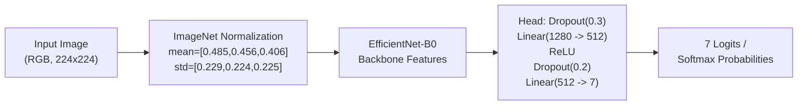

# Model Card: AI Skin Analysis 7-Class CNN Classifier

## 1. Model Summary

- **Model Architecture**: EfficientNet-B0 with custom multi-layer classification head
- **Task**: 7-Class Skin Condition Classification
- **Framework**: PyTorch / Torchvision
- **Production Checkpoint**: `models/trained/best_model.pth`
- **Checkpoint File Size**: `16,367,097 bytes` (15.6 MB)
- **MD5 Checksum**: `FF106263793F9F0A2FB13F15CEB1437E`
- **License / Usage**: Educational and research prototype only. **Strictly non-diagnostic.**

---

## 2. Model Architecture & Pipeline



### Preprocessing Specifications
- **Input Dimension**: `(Batch, 3, 224, 224)`
- **Color Format**: RGB
- **Normalization**: ImageNet standard (`mean=[0.485, 0.456, 0.406]`, `std=[0.229, 0.224, 0.225]`)

---

## 3. Evaluation on Held-Out Test Split

Evaluated on `data/split/test` comprising 622 images across 7 classes:

### 3.1 Aggregate Performance

| Metric | Score | Notes |
|---|---|---|
| **Overall Accuracy** | **95.82%** (596 / 622) | Top-1 accuracy |
| **Balanced Accuracy** | **94.58%** | Macro-average recall |
| **Top-2 Accuracy** | **99.68%** (620 / 622) | Only 2 samples missed in top 2 |
| **Top-3 Accuracy** | **100.00%** (622 / 622) | Ground truth is in top 3 for all test samples |
| **Macro Precision** | **96.24%** | Unweighted average precision |
| **Macro Recall** | **94.58%** | Unweighted average recall |
| **Macro F1 Score** | **94.91%** | Unweighted average F1 |
| **Weighted F1 Score** | **95.67%** | Class-weighted F1 |
| **Multi-class Brier Score** | **0.0780** | Mean squared probability error |
| **Expected Calibration Error (ECE)** | **2.88%** | 10-bin equal-width MSP partitioning |
| **Maximum Calibration Error (MCE)** | **61.24%** | Occurs in low-frequency bin |
| **Checkpoint Best Val Macro F1** | **93.48%** | Recorded during training checkpoint save |

### 3.2 Per-Class Breakdown

| Class | Precision | Recall | F1-Score | Support |
|---|---|---|---|---|
| `acne_vulgaris` | 99.62% | 99.62% | 99.62% | 261 |
| `impetigo` | 100.00% | 92.59% | 96.15% | 27 |
| `molluscum_contagiosum` | 90.48% | 100.00% | 95.00% | 19 |
| `psoriasis` | 84.51% | 99.17% | 91.25% | 121 |
| `urticaria` | 99.09% | 100.00% | 99.54% | 109 |
| `vitiligo` | 100.00% | 70.67% | 82.81% | 75 |
| `warts` | 100.00% | 100.00% | 100.00% | 10 |

### 3.3 Confusion Matrix Analysis

```
Predicted ->   Acne  Imp  Mol  Pso  Urt  Vit  Wart
True:
Acne (261)      260    0    1    0    0    0     0
Imp  (27)         1   25    0    0    1    0     0
Mol  (19)         0    0   19    0    0    0     0
Pso  (121)        0    0    1  120    0    0     0
Urt  (109)        0    0    0    0  109    0     0
Vit  (75)         0    0    0   22    0   53     0
Wart (10)         0    0    0    0    0    0    10
```

- **Vitiligo-to-Psoriasis Root Cause**: All 22 misclassified vitiligo test samples are sequential video frames from a single video (`IMG-0951`), which constitutes 32 out of the 75 vitiligo test samples (42.7%). The model misclassified 22 frames with high confidence (mean 92.43%) and correctly classified 10 frames. All 43 non-`IMG-0951` vitiligo test images were classified with 100.0% accuracy.

---

## 4. Confidence, Calibration & Safety Guardrails

### 4.1 Confidence Distribution & Overconfidence
- **Correct Predictions**: Mean confidence **98.11%**, median **99.71%**.
- **Incorrect Predictions ($N=26$)**: Mean confidence **90.46%**, median **97.86%**.
- **Key Reliability Risk**: The model exhibits high overconfidence even when making classification errors. 22 of the 26 errors fall in the High Confidence tier ($\ge 0.80$).

### 4.2 Integrated Safety Guardrails
1. **Advisory Triage Escalation**:
   - Confidence $< 0.80 \implies$ Caution flag in UI.
   - Low confidence ($< 0.60$) or red flag symptoms $\implies$ Escalates safety level from `routine` to `attention` or `urgent`.
   - **Note**: The system does not silently refuse to output a class; it surfaces cautionary triage warnings.
2. **Technical Image Rejection**:
   - Blurry (Laplacian $< 100.0$) or extreme brightness ($< 40$ or $> 220$) images are halted before CNN evaluation.
3. **Strict Non-Diagnostic Disclaimer**:
   - All predictions are flagged as preliminary educational analysis. Definitive medical diagnosis and prescription guidance are strictly prohibited.

---

## 5. Limitations & Appropriate Use

> [!CAUTION]
> The reported 95.82% test accuracy is measured on an academic held-out split with documented video burst duplication and near-duplicate leakage. It does **NOT** represent real-world clinical sensitivity or specificity across diverse patient populations.

- **Intended Users**: Students, triage trainers, and prototype researchers.
- **Out of Scope**: Autonomous clinical diagnosis, melanoma/oncology triage, emergency primary care.
