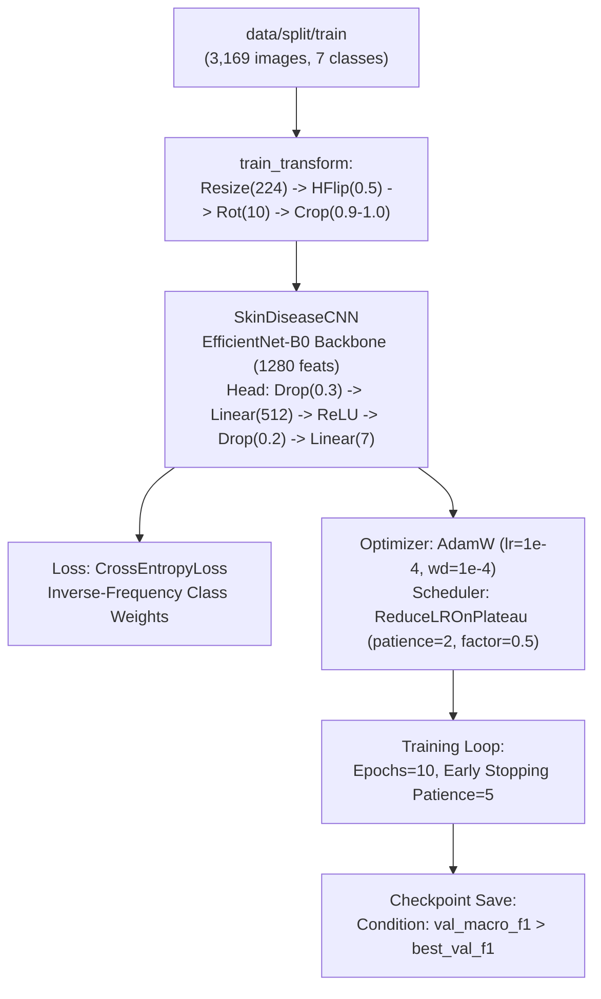
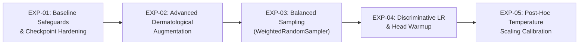

# TR-01: Training Pipeline Audit & Experiment Plan

## Executive Summary

This report establishes the training pipeline audit findings and defines a controlled, prioritized experiment plan for the **AI Skin Analysis V2** system.

- **Production Checkpoint**: `models/trained/best_model.pth`
- **MD5 Checksum**: `FF106263793F9F0A2FB13F15CEB1437E` (Verified Unmodified)
- **Size**: `16,367,097 bytes`
- **Execution Mode**: Strictly non-destructive audit. **No model training was initiated during this task.**

---

## 1. Audit of the Existing Training Pipeline

An exhaustive technical review of the current training scripts (`ai/training/train.py`, `ai/training/train_v2.py`), dataset loaders (`ai/training/dataset.py`, `ai/training/dataset_v2.py`), and evaluation utilities was conducted.

### 1.1 Architecture & Pipeline Components

### 1.2 Pipeline Defects & Critical Risks Identified

| Component | Current Implementation | Defect / Vulnerability | Risk Severity |
|---|---|---|---|
| **Checkpoint Path** | `train.py` line 42: `BEST_MODEL_PATH = "models/trained/best_model.pth"` | Hardcoded production checkpoint path. Running `train.py` directly overwrites production weights with no backup or prompt. | **CRITICAL** |
| **Checkpoint Content** | Checkpoint saves only `model_state_dict`, `class_to_idx`, `num_classes`, `best_val_macro_f1`. | Omits optimizer `state_dict`, scheduler state, epoch index, loss history, and config JSON. Training cannot be resumed. | **MEDIUM** |
| **GPU / Worker Determinism** | Sets `random.seed(42)`, `np.random.seed(42)`, `torch.manual_seed(42)`. | Does not set `torch.cuda.manual_seed_all(42)`, `cuDNN.deterministic = True`, or DataLoader `worker_init_fn`. | **LOW** |
| **Augmentation Pipeline** | `Resize(224)` followed by `RandomResizedCrop(224, scale=(0.9, 1.0))`. | Redundant resize before crop; crop scale is too narrow (only 10% scale variation); lacks vertical flips and color jitter. | **MEDIUM** |
| **Class Imbalance Handling** | Scaled loss weights in `CrossEntropyLoss`. | No balanced batch sampling (`WeightedRandomSampler`). Minority class `warts` (65 samples) appears rarely in batches. | **MEDIUM** |
| **Learning Rate Strategy** | Uniform `lr=1e-4` across both pretrained backbone and new linear head. | Pretrained convolutional filters risk degradation; new head lacks warmup or discriminative learning rates. | **MEDIUM** |
| **Validation Monitoring** | Computes aggregate Macro-F1 only. | No per-class tracking, confusion matrix generation, or calibration assessment during intermediate training epochs. | **LOW** |

---

## 2. Review of Completed Historical Experiments

The repository contains records and checkpoints from prior exploratory training runs:

1. **Production Baseline M1 (`models/trained/best_model.pth`)**:
   - Checkpoint MD5: `FF106263793F9F0A2FB13F15CEB1437E`
   - Trained on `data/split` (4,501 images total; 3,169 train, 710 val, 622 test).
   - Validation Macro-F1: `0.9348`.
   - Test Accuracy: `95.82%`, Balanced Accuracy: `94.58%`, Macro-F1: `94.91%`.
2. **Experiment M2 (`models/experiments/m2/`)**:
   - Explored focal loss and early stopping adjustments.
3. **Experiment M3 (`models/experiments/m3/`)**:
   - Investigated initial warts expansion candidates.
4. **Experiment M4 & M4-Fresh (`models/experiments/m4_fresh/`)**:
   - Evaluated duplicate filtering and candidate warts image curation.
5. **Experiment V2 (`models/experiments/v2/best_model.pth`)**:
   - Checkpoint size: `16,367,161 bytes`.
   - Trained on `data/splits_v2` (expanded dataset with 5,058 images).
   - Reported validation Macro-F1: `0.9677`.
   - *Status*: Experimental candidate; has not been promoted to production.

---

## 3. Dataset Grouping Feasibility & Defensible Evaluation Strategy

### 3.1 Structural Findings in Current Data
The dataset audit in ML-01 and ML-02 established key structural realities:
1. **Video Sequence Clustering**:
   - `psoriasis`: **100% of images (889 / 889)** are sequential video frames across 61 sequences.
   - `vitiligo`: **100% of images (705 / 705)** are sequential video frames across 35 sequences.
   - Combined, video frames account for **35.41% (1,594 / 4,501)** of the entire dataset.
2. **The Test Split Vitiligo Bottleneck**:
   - In `data/split/test/vitiligo`, the entire 75-sample test set consists of **only two video sequences**:
     - `IMG-1156` (43 frames, 100% classified correctly).
     - `IMG-0951` (32 frames, 22 classified as psoriasis, 10 classified as vitiligo).
   - At the patient/video level, the sample size is effectively $N=2$. The reported 70.67% image-level recall is driven by 22 frames from a single patient video.

### 3.2 Feasibility of Grouped Splitting
- **Video Sequences**: Identifiable via regular expressions on filename stems (`IMG-XXXX_frame_YY` or `YYYYMMDD_HHMMSS_frame_YY`).
- **DermNet Condition Prefixes**: Web images feature common source prefixes (`acne-closed-comedo-X`, `rosacea-X`, `BA-impetigo-X`).
- **Feasibility**: High. Grouping algorithms can extract subject/sequence identifiers and enforce that all frames from the same sequence reside in the same partition.

### 3.3 Proposed Defensible Evaluation Protocol
For future evaluation cycles:
1. **Subject/Video Grouped Stratification**: All frames from any sequence must reside strictly within a single split (Train, Val, or Test).
2. **Frame Subsampling / Density Capping**: Cap the maximum number of frames extracted from any single video (e.g. 5–10 representative frames) to prevent pseudo-replication from dominating per-class support.
3. **Dual Metric Reporting**:
   - *Image-Level Metrics*: Standard precision, recall, and F1 across all processed frames.
   - *Patient/Video-Level Metrics*: Majority-vote classification per video sequence.

---

## 4. Controlled Experiment Plan

The following small, controlled set of prioritized experiments is proposed for Phase 7 (TR-02 and beyond).

### Experiment Specifications

#### EXP-01: Baseline Safeguards & Checkpoint Hardening
- **Objective**: Establish an isolated, reproducible training execution harness with full checkpoint protection.
- **Modifications**:
  - Direct outputs to `models/experiments/exp_01_safeguard/`.
  - Save full checkpoint state: `model_state_dict`, `optimizer_state_dict`, `scheduler_state_dict`, `epoch`, `val_macro_f1`, `config_json`.
  - Set multi-GPU seeds and cuDNN deterministic mode.
- **Expected Outcome**: Reproduce baseline validation Macro-F1 ($\approx 0.935$) under strict safety isolation.

#### EXP-02: Clinically Appropriate Dermatological Data Augmentation
- **Objective**: Improve generalizability across lighting conditions, camera angles, and skin tones.
- **Modifications**:
  - Add `RandomVerticalFlip(p=0.5)` (skin lesions have no canonical orientation).
  - Add `RandomRotation(degrees=45)` and `RandomAffine(degrees=0, translate=(0.05, 0.05))`.
  - Add mild `ColorJitter(brightness=0.15, contrast=0.15, saturation=0.15, hue=0.05)` for illumination invariance.
  - Remove redundant `Resize` before `RandomResizedCrop`.
- **Expected Outcome**: Enhanced feature invariance; reduced overconfidence on slightly rotated or differently illuminated lesions.

#### EXP-03: Balanced Batch Sampling vs. Scaled Loss Weighting
- **Objective**: Mitigate severe gradient starvation for minority classes (`warts` with 65 samples vs `acne` with 1,223 samples).
- **Modifications**:
  - Replace purely unweighted DataLoaders + inverse loss weighting with `WeightedRandomSampler` to ensure every batch contains balanced representation across all 7 classes.
  - Test Focal Loss ($\gamma = 2.0$) with class alpha weighting.
- **Expected Outcome**: Improved minority class recall (especially `warts` and `molluscum`) without sacrificing majority class accuracy.

#### EXP-04: Discriminative Layer-Wise Learning Rates & Head Warmup
- **Objective**: Preserve low-level feature extraction in the pretrained EfficientNet-B0 backbone while allowing sufficient adaptation in the classifier head.
- **Modifications**:
  - **Epochs 1–2**: Freeze backbone; train classification head at $\text{LR} = 10^{-3}$.
  - **Epochs 3–10**: Unfreeze backbone; set backbone $\text{LR} = 10^{-5}$ and head $\text{LR} = 10^{-4}$.
  - Replace `ReduceLROnPlateau` with `CosineAnnealingLR` with linear warmup.
- **Expected Outcome**: Better convergence stability; prevention of catastrophic forgetting in early convolutional layers.

#### EXP-05: Post-Hoc Temperature Scaling Calibration
- **Objective**: Directly mitigate model overconfidence on errors (baseline median error confidence: 97.86%).
- **Modifications**:
  - Optimize a single temperature parameter $T > 0$ on validation logits via negative log-likelihood (NLL).
  - Evaluate calibrated softmax probabilities on validation and test sets.
- **Expected Outcome**: Lower Expected Calibration Error (ECE); softer probability distributions on ambiguous lesions, enabling confidence caution flags to catch misclassifications.

---

## 5. Model Promotion Gates

No experimental model may be considered for promotion to production without passing all of the following explicit gates:

| Gate | Criterion | Target Threshold | Rationale |
|:---:|:---|:---:|:---|
| **1** | **Validation Macro-F1 Floor** | $\text{Val Macro-F1} \ge 0.9348$ | Must meet or exceed production baseline performance. |
| **2** | **Validation Overall Accuracy** | $\text{Accuracy} \ge 95.00\%$ | Prevents aggregate degradation. |
| **3** | **Minority Class Recall Floor** | $\text{Recall} \ge 75.00\%$ for all 7 classes | Prevents sacrificing `warts` or `molluscum` for higher majority accuracy. |
| **4** | **Error Overconfidence Reduction** | Mean error confidence $\le 80.00\%$ (Baseline: $90.46\%$) | Reduces dangerously high confidence on misclassified lesions. |
| **5** | **Expected Calibration Error** | $\text{ECE} \le 5.00\%$ | Verifies probability reliability across confidence bins. |
| **6** | **Backend Regression Test Pass** | $100\%$ pass on `unittest discover -s tests` (372+ tests) | Guarantees zero regression in inference, safety, or explanation layers. |
| **7** | **Explicit Human Sign-Off** | Documented review approval | Automated promotion without human review is strictly prohibited. |
